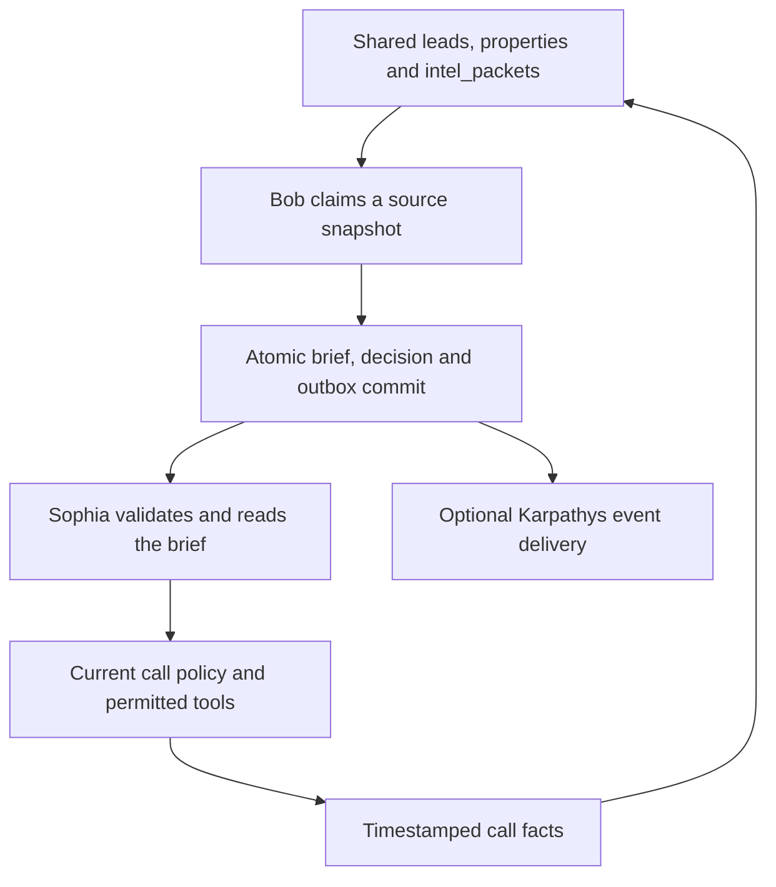

# Bob end-to-end audit and repair

Audited original Bob commit `16b6e55e85cf38c1d17eb438ac5eeb3f9243d9b9`, all 669 Python source lines and the complete tracked-file inventory. Compared its actual producers/consumers with REI's tested repair branch. Original code quality/integration grade: **D−**. Repaired local engineering grade: **B− provisional**. These are reviewer judgments, not measured production grades or a claim of A-level autonomous operation.

**38 findings: 32 addressed locally, four partial, two open.** Every finding, original failure and repair is recorded in [BOB-FINDINGS.json](BOB-FINDINGS.json) and [BOB-FINDINGS.md](BOB-FINDINGS.md). No service was deployed, migration applied to production, call placed or real recipient messaged.

## What Bob actually does

Bob was a deterministic call-planning worker, not a market intelligence model. `backend/intel` and `backend/scoring` were empty. It had no comps ingestion, language-model integration, deal simulation, offer calculation, durable job queue, tests or CI.

Its implemented job was to read candidate leads, memory and an intelligence packet; choose a missing question, phase, mood, avoidances and escalation hints; update the shared lead's `call_brief`; log a decision; and emit events toward Karpathys. The shared database is the connection to Sophia. Neither sending an event nor saving a brief grants permission to dial or quote.

## The actual connection

| Boundary | Original behavior | Repaired behavior |
|---|---|---|
| Intelligence | Bob read `lead_intel_packets`; REI writes `intel_packets` | Same tenant-bound `intel_packets` snapshot |
| Seller memory | Bob read `seller_memory`; Sophia persists fields on `leads` | Same lead row plus timestamped verified checklist facts |
| Property | Bob assumed a reverse FK relationship; REI creates leads using `property_id` | Tenant-bound `leads.property_id → properties.id` |
| Brief | Shared `leads.call_brief`, with no version or expiration | V2, bound lead, UTC creation/expiry, typed bounded values |
| Consumer | Many fields stored but never used | Objective, focus, opener, reported mood and escalation guidance included as advisory input |
| Live dialogue | Static missing-box focus injected repeatedly | Pre-call focus/opening stops after early turns; current requests and facts take priority |
| Permissions | A brief and ready event could imply operational readiness | `ready_for_call` always false; actual dialing/tool authority remains REI's separately verified preflight |
| Call feedback | Different memory tables and loose proxies broke continuity | Low-confidence speech creates no verified facts; retractions replace confirmations; call-bound RPC merges newer evidence |
| Karpathys | Unauthenticated sends to a different path, scheduled on an idle loop | Durable synchronous delivery follows REI's `/api/ingest/...` and `X-Karpathys-Secret` convention; real receiver remains unverified |

## Reproduced failures

[Original reproduction output](test-evidence/original-reproductions.json) captures a fixed June 7 refresh cutoff; a wrong-number summary causing ownership to be skipped; a $250,000 approval threshold rendered as $25,000,000; and a pending event task on a worker loop that never ran.

Additional inspection found independent brief/log/event writes, ignored HTTP failures, no tenant constraints or generation ownership, unsupported confidence values, inferred seller moods and two divergent planner implementations. A full REI assembly regression also reproduced dollars being compared with cents, manufacturing price conflicts despite passing cents-only helper tests.

## Repairs and guardrails

Bob now claims one job immediately before processing it, using database generation tokens and bounded leases. Source snapshots include the lead's memory, property and packet. A stale token, expired lease or changed snapshot cannot commit. Brief, local decision record and outbox event share a transaction; a failed decision insert rolls all three back.

Failures back off; five failed jobs quarantine the lead for review. Event delivery uses a bounded request, checks status, retains stable event IDs across retry, requires an owned acknowledgment and dead-letters after ten delivery failures. SIGTERM/SIGINT stops new claims. DB timeouts are ten seconds and event requests three seconds. External delivery defaults off and requires explicit HTTPS/secret configuration.

Checklist planning uses explicit source/timestamp evidence, never call count, generic hot topics or a database address as confirmation. Every one of the 128 possible checklist subsets is tested for priority. Confidence now means the fraction of checklist items with fresh confirmed evidence; it is not an accuracy probability. Missing or uncertain seller mood stays unknown. STOP explicitly takes immediate suppression/end priority rather than waiting for operator approval.

The matching Sophia change rejects legacy, malformed, expired and wrong-lead briefs and clears old brief state. It does not change permission grants or manufacture an initial conversation stage. Caller requests and current verified facts stay authoritative. It records fact provenance from clear frames, and persists facts through a tenant/call-bound RPC; a missing optional context field cannot prevent normal post-call work.

Money thresholds and actual intel conflict assembly now preserve integer cents. Structured ARV/MAO values declare `USD_cents`; invalid money yields a conflict instead of arithmetic or implied authority. No Bob brief calculates or approves an offer.

## Test evidence

| Campaign | Result | Limits |
|---|---|---|
| Bob Python suite | **206 passed** | Actual rules and mocked network/DB contracts; no production credentials |
| Bob coverage | **88.0% statements, 69.5% branches, 83.4% combined** | Remaining untested branches matter; green tests do not certify production |
| Real migration in embedded PostgreSQL | **33 checks passed** | Includes source races, rollback, tenant isolation, leases, old-fact rejection and event retry |
| Queued claim stress | **256 attempts, exactly one generation** | PGlite serializes requests; not proof across independent PostgreSQL backends |
| REI full regression | **1,354 passed** | Includes 51 new cross-contract, facts, payload and cents-boundary cases; four dependency warnings |
| Static and dependency checks | Pass | Critical/unused-import checks on backend/new tests, compile, whitespace and compatible locked Bob environment |
| Live integrations | **Not run** | No verified staging database, receiver or phone-provider configuration |

Evidence: [Bob pytest](test-evidence/bob-pytest.txt), [coverage](test-evidence/coverage.json), [database contracts](test-evidence/database-tests.json), [lint](test-evidence/lint.txt), and [matching REI results](test-evidence/rei-pytest.txt). Tests are executable under `tests/`; dependencies are pinned and locked. The new hosted workflow also runs SQL contracts.

## Better responsibilities and jobs

| Component | Owns | Must not infer or perform |
|---|---|---|
| Bob evidence analyst | Normalize fresh confirmed facts, invalidate stale plans, rank missing information, explain plan provenance | Caller identity from call count; current emotion from foreclosure records |
| Bob conversation planner | One useful next objective, avoidances, handoff triggers and low-pressure preparation | Tool authority, guaranteed appointments, fabricated prices or human identity |
| Verified comps/valuation service | Sourced comparable sales, confidence, integer-cent ARV/MAO and freshness | An unapproved binding offer |
| Human/operator governance | Explicit scoped approvals, conflicts, title/legal questions and final commercial decisions | Silent defaults to approval or authority transferred through a prose brief |
| Sophia | AI disclosure, listening, corrections, immediate STOP and execution of separately authorized tools | Treating cached planning guidance as permission or verified live consent |
| REI scheduler | Confirmed availability, bookings, callback ownership, provider outcomes and reminder lifecycle | Claiming acceptance means completed transfer or cancelled appointment |
| Event relay | Idempotency, delivery retry, leases and observable dead letters | Treating an event as independent dial authorization |
| QA/operations | Recorded reviews, context correctness, queue age, health alerts and recovery drills | Replacing real-call evidence with scripted text or coverage counts |

Useful next Bob jobs are consented-recording review, missed-fact analysis and source-quality alerts. Add a model-based planning or simulation role only after shared contracts, data provenance, action containment and measured evaluation exist. The current repair makes the implemented planner safer; it does not manufacture the missing market intelligence engine.

## Remaining A-level blockers

- **Shared baseline and real deployment:** both services need the same confirmed Supabase schema/project/tenant. The new migration adds Bob-owned infrastructure but does not reconstruct all missing REI source tables. Test clean installation, independent-backend concurrency, database outages and worker termination against actual staging.
- **Real event receiver:** verify its route, authentication, event schema, duplicate handling and downstream completion. The repaired sender follows the convention visible in REI, not an inspected receiver. Keep external delivery disabled until that contract passes.
- **Durable REI handoff:** Bob's brief/event transaction is durable; REI can still die before its post-call fact RPC. Persistent REI post-call work/outbox and recorded recovery remain required.
- **Legacy modules:** embedded older planner helpers remain. Their unversioned briefs are ignored; consolidate or retire them deliberately after owner-call workflow review.
- **Operational monitoring:** configure heartbeat/queue-age/quarantine/dead-letter alerts, retention and backups. Durable state without monitoring can accumulate unattended failures.
- **Real voice and remaining workflows:** earlier acoustic gaps, real conversations, operator approval delivery and cancel/reschedule tools remain separate REI release blockers. This audit does not certify them.

The worker's checked-in environment file contained a placeholder service key. It was removed from the new tree and ignored; the local file and repository history were preserved. No live credential leak or credential rotation is claimed.

For coordinated staging setup, RPC ownership, dependencies and operating instructions, read [README.md](../README.md). Apply Bob's migration once, keep outbound disabled, and validate both repairs together before production.
